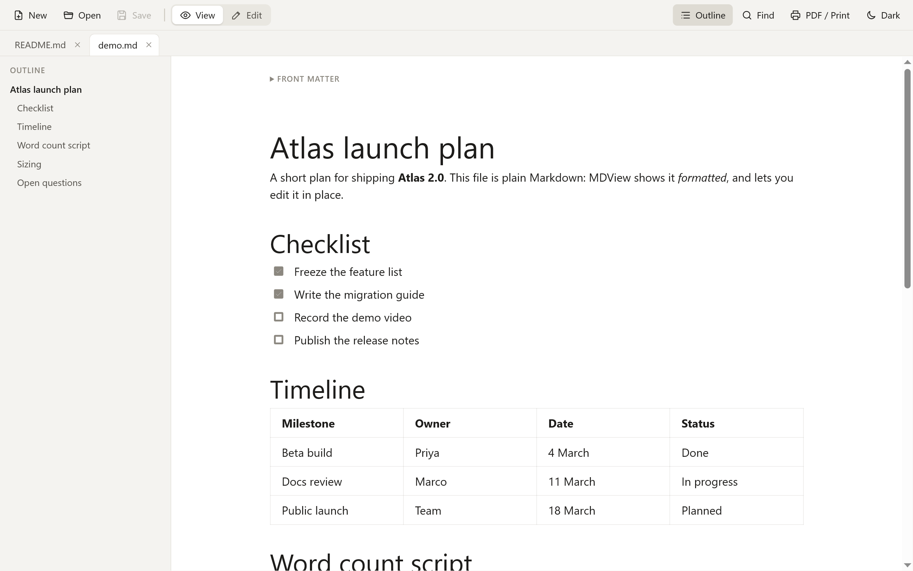
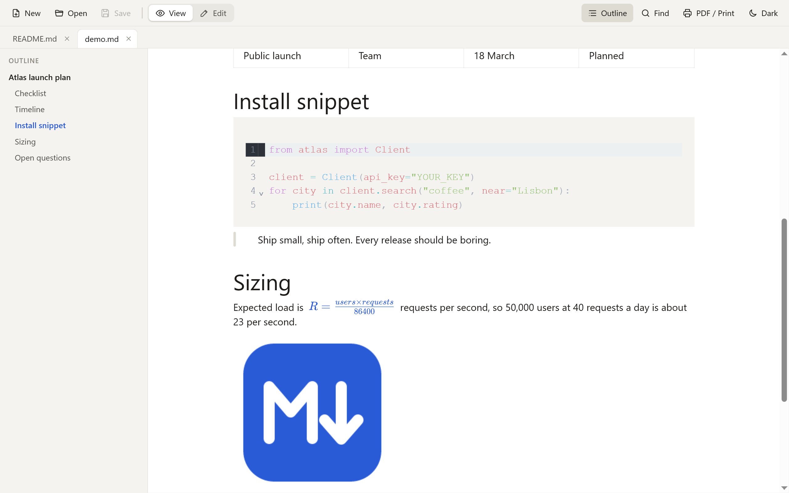

<p align="center">
  
</p>

<h1 align="center">MDView</h1>

<p align="center">
  <b>Double-click a Markdown file. Read it. Edit it. Done.</b><br />
  A light, offline Markdown viewer and editor for Windows, macOS and Linux.
</p>

<p align="center">
  <a href="https://github.com/devsharmagrowleads-oss/mdview/releases/latest"></a>
  
  
  
  
  
</p>

<p align="center">
  <a href="#-download">Download</a> ·
  <a href="#-features">Features</a> ·
  <a href="#-how-to-use">How to use</a> ·
  <a href="#%EF%B8%8F-keyboard-shortcuts">Shortcuts</a> ·
  <a href="#-good-to-know">Good to know</a>
</p>

<p align="center">
  <picture>
    <source media="(prefers-color-scheme: dark)" srcset="docs/screenshots/view-dark.png" />
    
  </picture>
</p>

## Why MDView

AI tools write Markdown all day: plans, specs, READMEs, notes. Reading one usually means opening a code editor and finding the preview button.

MDView makes a `.md` file behave like any other document. Double-click it and it opens, formatted, in a small fast window. The installer is about **2.4 MB** on Windows, because MDView uses the webview already built into your system instead of shipping its own browser.

It is free for everyone, works with no internet connection, and never sends anything anywhere.

## 📦 Download

| Your computer | File to download |
| --- | --- |
| **Windows** 10 / 11 | [`MDView_0.1.0_x64-setup.exe`](https://github.com/devsharmagrowleads-oss/mdview/releases/download/v0.1.0/MDView_0.1.0_x64-setup.exe) |
| **macOS** (Intel and Apple Silicon) | [`MDView_0.1.0_universal.dmg`](https://github.com/devsharmagrowleads-oss/mdview/releases/download/v0.1.0/MDView_0.1.0_universal.dmg) |
| **Linux** (Debian, Ubuntu) | [`MDView_0.1.0_amd64.deb`](https://github.com/devsharmagrowleads-oss/mdview/releases/download/v0.1.0/MDView_0.1.0_amd64.deb) |
| **Linux** (Fedora, RHEL) | [`MDView-0.1.0-1.x86_64.rpm`](https://github.com/devsharmagrowleads-oss/mdview/releases/download/v0.1.0/MDView-0.1.0-1.x86_64.rpm) |
| **Linux** (any) | [`MDView_0.1.0_amd64.AppImage`](https://github.com/devsharmagrowleads-oss/mdview/releases/download/v0.1.0/MDView_0.1.0_amd64.AppImage) |

Newer versions, when there are any, are on the [releases page](https://github.com/devsharmagrowleads-oss/mdview/releases/latest).

> [!NOTE]
> The installers are not code-signed yet, so your system will ask before running them.
> **Windows:** click **More info**, then **Run anyway**.
> **macOS:** right-click the app, choose **Open**, then **Open** again. You only do this once.

## ✨ Features

| | |
| --- | --- |
| 📂 **Opens on double-click** | Installs as the app for `.md`, `.markdown`, `.mdown` and `.mkd` files. |
| 👁️ **View and Edit modes** | Files open read-only. Switch to Edit and type straight into the formatted page. |
| 🗂️ **Tabs** | Several files in one window. Opening another file adds a tab. |
| 🧭 **Outline** | A sidebar built from the headings; click to jump. |
| 🔎 **Find** | Search the document with a match count and next / previous. |
| 🖨️ **PDF and print** | Send the formatted document to a printer or save it as a PDF. |
| 🌗 **Light and dark** | One click to switch; your choice is remembered. |
| 🔄 **Live reload** | When another program rewrites the file, the view refreshes by itself. |
| 🧱 **Rich Markdown** | Tables, task lists, highlighted code, math, quotes and local images. |
| 🧾 **Front matter** | YAML at the top of a file is tucked into a panel and saved back untouched. |
| 🔒 **Private** | Fully offline. Web images are never fetched, so opening a file tells no one. |

### Read

Code blocks are highlighted, math is typeset, and images stored next to the document are shown.

<p align="center">
  
</p>

### Edit

Press **Edit** and the page becomes editable, with a formatting bar for headings, lists, tables, links, code and math. There is no separate "source" pane to manage.

<p align="center">
  
</p>

### Find

<p align="center">
  
</p>

### Start screen

<p align="center">
  
</p>

## 🚀 How to use

1. **Install it.** Download the file for your computer from the table above and run it.
2. **Open a file.** Double-click any `.md` file. You can also drag a file onto the MDView window, or press **Open**.
   If `.md` files still open in another app, right-click one, choose **Open with**, pick MDView and tick **Always**.
3. **Read.** Use **Outline** to jump between sections and **Find** to search. **Dark** / **Light** switches the theme.
4. **Edit.** Press **Edit**, then type. Use the formatting bar, or type `/` on an empty line for a menu of blocks. Press **Save** when you are done; a dot on the tab means there are unsaved changes.
5. **Share.** Press **PDF / Print** and choose "Save as PDF" in the print dialog to get a PDF.

Working alongside an AI tool? Leave the file open in MDView. Each time the tool rewrites it, the view updates on its own.

## ⌨️ Keyboard shortcuts

On macOS use <kbd>Cmd</kbd> in place of <kbd>Ctrl</kbd>.

| Action | Shortcut |
| --- | --- |
| Open a file | <kbd>Ctrl</kbd> <kbd>O</kbd> |
| New document | <kbd>Ctrl</kbd> <kbd>N</kbd> |
| Save | <kbd>Ctrl</kbd> <kbd>S</kbd> |
| Save as | <kbd>Ctrl</kbd> <kbd>Shift</kbd> <kbd>S</kbd> |
| Start editing | <kbd>Ctrl</kbd> <kbd>E</kbd> |
| Switch between View and Edit | <kbd>Ctrl</kbd> <kbd>Shift</kbd> <kbd>E</kbd> |
| Find | <kbd>Ctrl</kbd> <kbd>F</kbd>, then <kbd>Enter</kbd> / <kbd>Shift</kbd> <kbd>Enter</kbd> |
| Show or hide the outline | <kbd>Ctrl</kbd> <kbd>\</kbd> |
| PDF / Print | <kbd>Ctrl</kbd> <kbd>P</kbd> |
| Close the tab | <kbd>Ctrl</kbd> <kbd>W</kbd> |
| Next / previous tab | <kbd>Ctrl</kbd> <kbd>Tab</kbd> / <kbd>Ctrl</kbd> <kbd>Shift</kbd> <kbd>Tab</kbd> |
| Follow a link while editing | <kbd>Ctrl</kbd> + click |

## 💡 Good to know

- **A file you only view is never changed.** Saving an edited file rewrites its Markdown in a consistent style (table columns are padded to line up, for example). The content stays the same; the raw text can differ slightly.
- **Web images are left blank.** MDView never goes online, so only images stored on your computer are shown.
- **Raw HTML is shown as text,** not rendered.
- **Pasting an image into a document is not supported yet.**
- **Files that are not UTF-8 text open read-only,** so they cannot be damaged.
- The macOS and Linux builds are produced automatically and have had less hands-on testing than the Windows one. If something is off, please [open an issue](https://github.com/devsharmagrowleads-oss/mdview/issues).

## 🛠️ Build it yourself

You need [Node.js](https://nodejs.org) 20.19 or newer on the 20.x line, or 22.12 or newer (required by the Vite version this project uses), [Rust](https://rustup.rs) and the [Tauri prerequisites](https://tauri.app/start/prerequisites/) for your system.

```sh
npm install
npm run app:dev      # run the app with hot reload
npm run app:build    # build the installer for the system you are on
```

Pushing a version tag such as `v0.2.0` makes GitHub Actions build the installers for all three systems and attach them to a draft release.

```
index.html, src/     the interface (TypeScript, Milkdown Crepe editor)
src-tauri/           the desktop shell (Rust): files, file associations, single window
docs/                logo, screenshots and the demo document shown above
```

## License

[MIT](LICENSE). Free to use, share and modify.

---

<p align="center">
  <b>MDView is made by Dev Sharma.</b>
</p>
