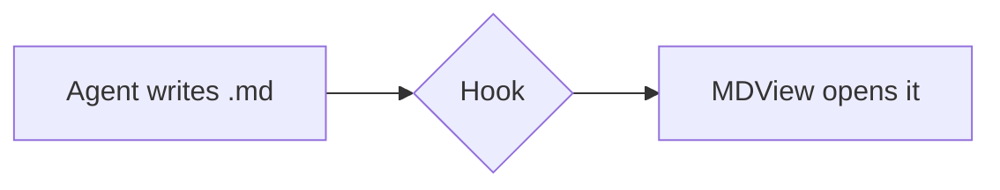

# MDView macOS test: instructions for Claude Code

> Give this whole file to Claude Code, running in a clone of
> `https://github.com/devsharmagrowleads-oss/mdview` on the `ai-agent-integration` branch.
> It tests MDView on this Mac and writes `mac-test-report.md`. It does not change the
> app's code.

---

You are testing **MDView 0.2.0 on macOS**. MDView is a desktop Markdown viewer (Tauri 2:
Rust backend in `src-tauri/`, TypeScript frontend in `src/`). Version 0.2.0 adds AI-agent
features. They were built and tested on **Windows only**; this is the first test on a Mac.
Your job is to find out, with evidence, what works and what doesn't on this Mac, then write
a report. **Do not modify the app's source code**, even when you find the cause of a bug;
describe the cause and a suggested fix in the report instead.

Read `README.md` and `integrations/README.md` first for what each feature is supposed to do.

## Ground rules

1. **Ask the user before** changing anything outside this repository and a scratch folder:
   their Claude Code / Codex / Gemini config, default apps, `/usr/local/bin`, `/Applications`.
   Back up any config file before a test touches it, and restore it afterwards.
2. Use a scratch folder for test files: `export T=$(mktemp -d)/mdview-test` and `mkdir -p $T`.
3. **Record evidence for every result**: the command and its output, a screenshot path, or
   what the user told you. "Seems to work" is not a result.
4. When a step needs the user's eyes or hands (clicking in the app, a permission prompt),
   ask them precisely what to do and what to report back, one step at a time. If you can
   take screenshots (`screencapture -x "$T/shot.png"`, then read the image), do that instead
   of asking. Taking screenshots may need Screen Recording permission for the terminal app
   (System Settings → Privacy & Security).
5. If a step fails, capture the exact error, mark it FAIL and **continue with the next test**.
   Don't stop at the first failure.
6. Keep a running log as you go; it becomes the report.

## Step 0: Environment

Record: `sw_vers`, `uname -m` (arm64 = Apple Silicon), `node --version`, `rustc --version`
(if installed), `git rev-parse HEAD`, and whether Claude Code, Codex, Gemini CLI and VS Code
are installed (`which claude codex gemini code`).

## Step 1: Get the app (try both A and B if you can)

**A. The CI build (what users will download).** Ask the user for the macOS `.dmg` from the
GitHub Actions run (the repo owner will share the link; it is in the artifact named
`MDView-macOS`). Then:

```sh
hdiutil attach MDView_0.2.0_universal.dmg
cp -R "/Volumes/MDView/MDView.app" /Applications/    # ask first
```

Open it once from Finder: right-click → Open → Open (it is not notarized). Record exactly what
macOS says. If it says the app "is damaged", record that (it is a real finding), then run
`xattr -dr com.apple.quarantine /Applications/MDView.app` and try again.

**B. Build from source** (needs Rust: https://rustup.rs and Node 20+):

```sh
npm ci
npx tsc --noEmit
(cd src-tauri && cargo test)
npx tauri build --bundles app,dmg -c '{"bundle":{"createUpdaterArtifacts":false}}'
```

(The override skips update signing, which needs the owner's private key.) Record whether each
command succeeds and copy any errors in full. The app is then in
`src-tauri/target/release/bundle/macos/MDView.app`.

From here on, `MDV="/Applications/MDView.app/Contents/MacOS/mdview"` (or the built app's path).
Check the binary name with `ls /Applications/MDView.app/Contents/MacOS/` and adjust if needed.

## Step 2: Command line (you can do all of these yourself)

| ID | Test | How | Expected |
|---|---|---|---|
| C1 | Version | `"$MDV" --version` | prints `mdview 0.2.0` and returns at once |
| C2 | Help | `"$MDV" --help` | usage text |
| C3 | Open a file | create `$T/a.md` with a heading, then `"$MDV" "$T/a.md"` | MDView window shows it formatted; the terminal is **not** blocked (the command returns) |
| C4 | Second file, same window | with MDView open: `"$MDV" "$T/b.md"` | a second **tab** in the same window; `pgrep -x mdview \| wc -l` (or `pgrep -fl MDView`) shows **one** app process after a few seconds |
| C5 | `open` command | `open -a MDView "$T/c.md"` | opens as a tab |
| C6 | Link | `open "mdview://open?path=$(python3 -c 'import urllib.parse,sys;print(urllib.parse.quote(sys.argv[1]))' "$T/a.md")"` | MDView shows `a.md` |
| C7 | Watch a folder | `"$MDV" --watch "$T/proj"` (make the folder first), then after 2 s write `$T/proj/docs/new.md` | `new.md` opens by itself within ~2 s and is listed under **Activity** |
| C8 | Live reload + change highlight | with `a.md` open and showing, append a paragraph to it from the shell | the view updates by itself, the new paragraph is tinted green with a bar in the margin, and a pill says "1 part changed" with **Next** |
| C9 | Agent hook (Claude Code format) | `echo '{"tool_name":"Write","tool_input":{"file_path":"'$T'/hook.md"}}' \| time "$MDV" --hook` after creating `hook.md` | returns in **well under 1 s**, exit code 0, and `hook.md` opens in MDView |
| C10 | Hook ignores non-Markdown | same with a `.txt`/`.py` path that isn't Markdown (`.txt` counts as a document; use `.py`) | nothing opens, exit 0 |
| C11 | `--from-agent` | `"$MDV" --from-agent "$T/agent.md"` | opens; window comes forward for a new file |
| C12 | MCP server | run the script below | `initialize` answers, `tools/list` returns `open_markdown`, `show_markdown`, `watch_folder`; `show_markdown` opens a document titled after the title you pass |

MCP check (C12):

```sh
python3 - "$MDV" <<'EOF'
import json, subprocess, sys
msgs = [
  {"jsonrpc":"2.0","id":1,"method":"initialize","params":{"protocolVersion":"2025-06-18","capabilities":{},"clientInfo":{"name":"t","version":"1"}}},
  {"jsonrpc":"2.0","method":"notifications/initialized"},
  {"jsonrpc":"2.0","id":2,"method":"tools/list"},
  {"jsonrpc":"2.0","id":3,"method":"tools/call","params":{"name":"show_markdown","arguments":{"title":"MCP test","markdown":"# MCP test\n\nShown by the MCP server."}}},
]
p = subprocess.run([sys.argv[1], "--mcp"], input="\n".join(map(json.dumps, msgs)) + "\n", capture_output=True, text=True, timeout=20)
print("exit", p.returncode); print(p.stdout); print("stderr:", p.stderr)
EOF
```

Also check that the MCP process **exits** promptly when its input closes (the script would time
out otherwise).

## Step 3: AI agent connections (ask the user first)

Explain to the user that **Settings → Connect** edits their agent's config, that MDView makes a
backup, and that you will disconnect and verify the file is restored. Then, for each agent that is installed:

1. Copy the config file aside yourself too (`~/.claude/settings.json`, `~/.codex/AGENTS.md` and
   `~/.codex/config.toml`, `~/.gemini/GEMINI.md` and `~/.gemini/settings.json`).
2. Ask the user to open Settings (gear icon, or ⌘,) and press **Connect** for that agent.
3. Inspect what changed (`diff` against your copy). Expected:
   - Claude Code: one `PostToolUse` hook whose command is `"<path to mdview>" --hook`, plus
     `~/.claude/commands/mdview.md`. Nothing else in the file may change.
   - Codex: a block between `<!-- mdview:start -->` / `<!-- mdview:end -->` in AGENTS.md and a
     `[mcp_servers.mdview]` block in config.toml.
   - Gemini: a block in GEMINI.md and `mcpServers.mdview` in settings.json.
4. **Real-agent test (Claude Code, the main feature):** in a *new* Claude Code session, ask it
   to write a short Markdown file. Expected: the file opens in MDView within a second or two.
   Then ask it to edit that file. Expected: MDView updates and highlights the change without
   stealing focus.
5. Ask the user to press **Disconnect**, then `diff` against your copy. Expected: identical
   content (whitespace/key order aside); record any difference.

## Step 4: In the window (the user clicks, or you use screenshots)

Use a document with a Mermaid diagram, a table with numbers, a task list, and inline code that
names files. `docs/demo.md` in the repo is a good start; add:

````md


| Repo | Stars | Gain |
| --- | --- | --- |
| alpha | 1,200 | +300 |
| beta | 98,000 | +12 |
| gamma | 5.2k | +4,100 |

See `src/main.ts:12` and `README.md`.
````

| ID | Test | Expected |
|---|---|---|
| U1 | Diagram | the Mermaid block is drawn as a diagram, in both Light and Dark themes |
| U2 | Sort & filter | hovering the table shows **Sort & filter**; sorting **Stars** handles `1,200` / `98,000` / `5.2k` as numbers; filtering works; **Copy as CSV** puts CSV on the clipboard; the document itself is unchanged |
| U3 | File references | clicking `README.md` opens it in a tab; clicking `src/main.ts:12` opens VS Code at line 12 (or shows the file in Finder if VS Code is not installed); a toast says which |
| U4 | Export → Copy formatted | paste into Mail or Notes (or a Google Doc): headings, table and a **picture** of the diagram appear |
| U5 | Export → Save as HTML | open the file in Safari: formatted, diagram visible |
| U6 | Export → Save as Word | open in Word or Pages if installed: formatted, table and diagram picture present. (Pages may not support this kind of .docx; say which app you used.) |
| U7 | Export → PDF or print | the print dialog opens; "Save as PDF" produces a clean PDF |
| U8 | Paste to open | copy a path to a `.md` file, click in MDView (not in Edit mode), press ⌘V: it opens. Copy some Markdown text, ⌘V: it opens as a new tab |
| U9 | Clipboard shortcut | in another app, copy a `.md` path, press **Control+Option+M**: MDView comes forward with that file. Also confirm **⌘⌥M** still minimises windows normally (MDView must not take it) |
| U10 | Activity panel | lists files from the tests above with "New / Edited / From agent"; the badge count clears as files are viewed; **Clear** empties it; watched folders can be added with **Add** and removed with × |
| U11 | Settings window | opens with ⌘, and with the gear; on macOS there should be **no** "Default app" / "Terminal command" section (those are Windows-only); agent rows show Connected / Not found correctly |
| U12 | Edit mode | Edit, type, ⌘S saves; closing a tab with unsaved changes asks first |
| U13 | Keyboard | ⌘O, ⌘N, ⌘F, ⌘\\, ⌘W, ⌘P, ⌘Q (⌘Q must ask about unsaved changes) |
| U14 | Updates | Settings → **Check now** gives a clear message (there is no published 0.2.0 release yet, so "up to date" or a readable error are both acceptable; a hang or crash is not) |

## Step 5: Default app and ⌘-click from the terminal (ask the user)

1. Ask the user to make MDView the default for `.md`: Finder → select any `.md` → ⌘I (Get Info) →
   Open with: MDView → **Change All…**
2. `open "$T/a.md"` → opens in MDView.
3. In Terminal/iTerm (or the terminal Claude Code runs in), print a file name that Claude Code
   would show, and ⌘-click it. Record which terminal app and whether MDView opened it.

## Step 6: Clean up

Disconnect any agents you connected (verify with diff), restore any config you backed up, ask the
user before removing anything from `/Applications` or `/usr/local/bin`, and delete `$T`.

## Step 7: The report

Write `mac-test-report.md` in the repository root (do not commit it) with:

1. **Environment**: macOS version, chip, how the app was obtained (A, B or both), commit hash.
2. **Summary**: counts of PASS / FAIL / PARTIAL / NOT TESTED, and the 3 most important problems.
3. **Results table**: every test ID above (C1–C12, Step 3, U1–U14, Step 5) with columns
   `ID | Test | Result | Evidence | Notes`. Results: PASS, FAIL, PARTIAL, NOT TESTED (say why).
4. **Failures in detail**: for each FAIL/PARTIAL: exact steps, expected vs actual, full error
   text or log output, screenshot paths, and your best guess at the cause with the file and
   function involved (for example `src-tauri/src/launch.rs`, `spawn_detached`). Don't fix it.
5. **Build problems** (Step 1B), quoted in full.
6. **Anything else odd**: layout glitches, slow parts, confusing wording, macOS permission
   prompts that appeared and what triggered them.
7. **Cleanup**: what you restored or removed, and what is still installed.

Finish by telling the user where the report is and asking them to send it to the repo owner.
